# Basic Electronics

This section of the **Xii-Boy Ultra Guide** covers the basics on how the Wii and other circuits work. Please read through this section thoroughly and confirm understanding of all core concepts. This is crucial when troubleshooting and understanding the build.

### What is a Circuit?

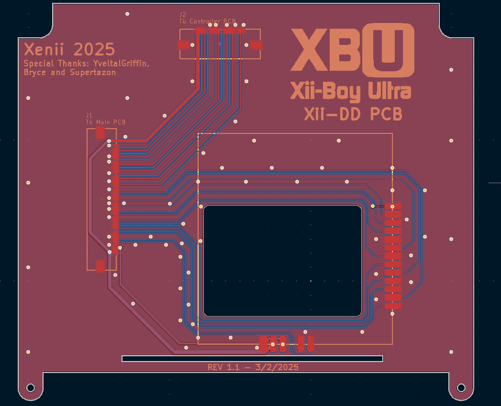

An electrical circuit is a pathway that carries electricity from a power source, such as a battery, through components (e.g. light bulbs or motors) to perform work. It consists of wires and components that form a closed loop for current to flow. When the circuit is complete, electricity flows, and the components function. If the loop is broken, the flow stops, and the components will not work.

### What is a PCB?

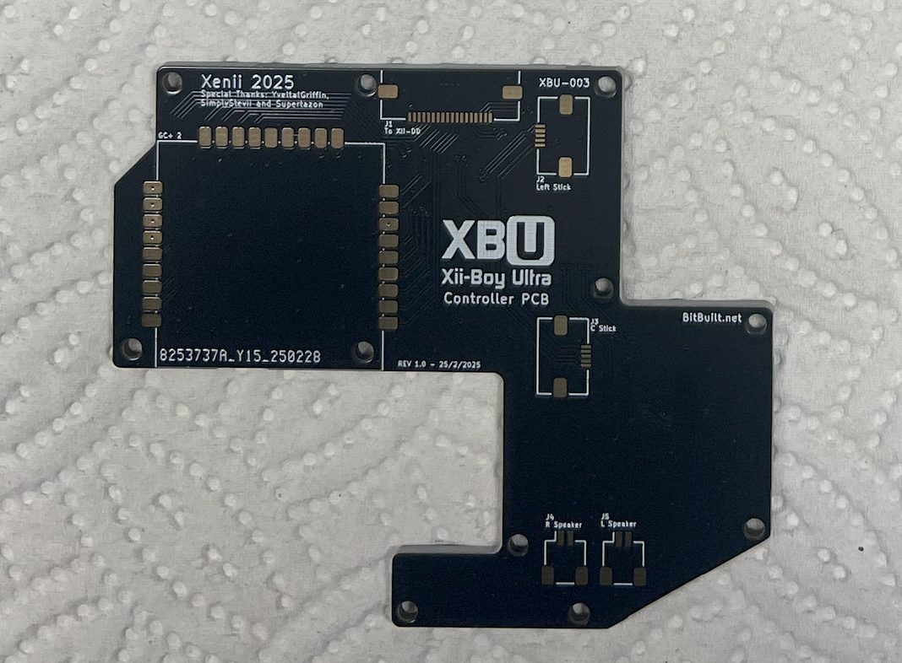

A PCB (**P**rinted **C**ircuit **B**oard) consists of multiple layers of copper traces and vias that act as wires, allowing electrical signals to travel between components. These boards are populated with electronic components and connectors to form a complete circuit, and they can also connect to other PCBs.

### What is an FPC?

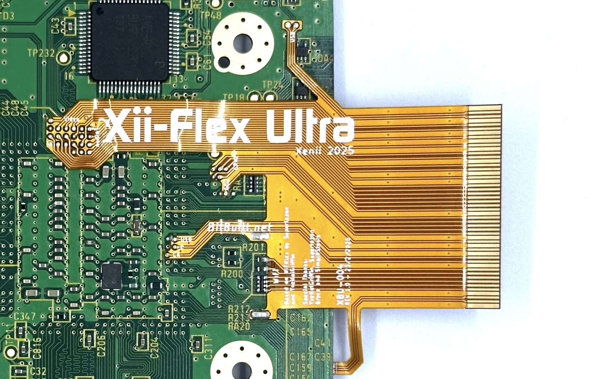

An FPC (**F**lexible **P**rinted **C**ircuit) is a flexible version of a PCB. The Xii-Boy Ultra uses an FPC for its **Xii-Flex Ultra**, built on the same concept as a rigid PCB, but with added flexibility.

### What is an FFC?

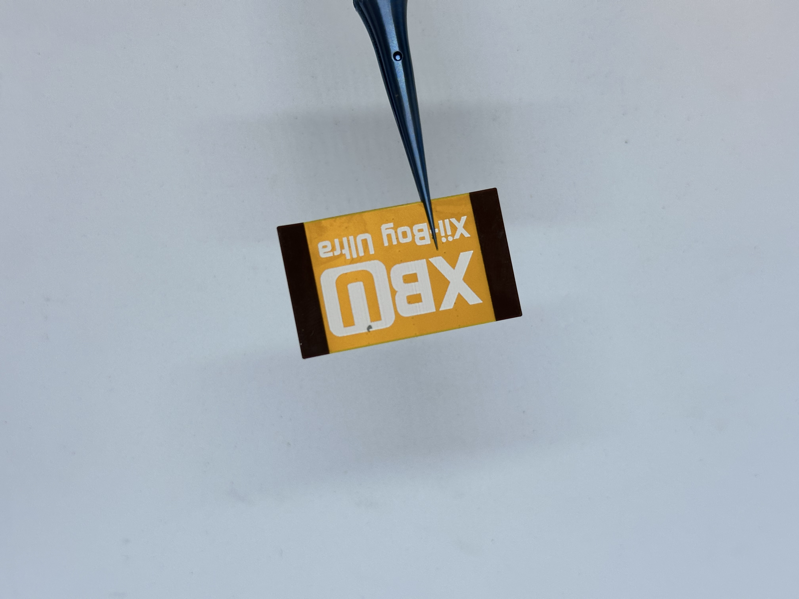

An FFC (**F**lexible **F**lat **C**able) is a flat, flexible cable used to connect electronic components or PCBs together. It’s similar to an FPC but in a flat, ribbon-like form, making it ideal for tight spaces. They are typically purchased off the shelf, and do not include custom circuitry, unlike FPCs. FFCs have colored tips at the ends (often blue), and those are called stiffeners.

### What is a ZIF Connector?

A ZIF (**Z**ero **I**nsertion **F**orce) connector is a type of connector used in electronics where the connection is made without requiring any force to be applied when inserting or removing the cable. ZIF connectors are typically used for connecting FPCs and FFCs to a circuit board. The main feature of a ZIF connector is its ability to securely hold the cable in place with little mechanical stress.

To insert a cable, follow this process:

1. Unlock the ZIF connector by prying up on the latch.
2. Align the FPC/FFC with the connector and gently insert it at an angle.
3. Close the locking mechanism, while the cable is still inserted. This gently secures the cable into place without applying any direct force.

### What is a Trace?

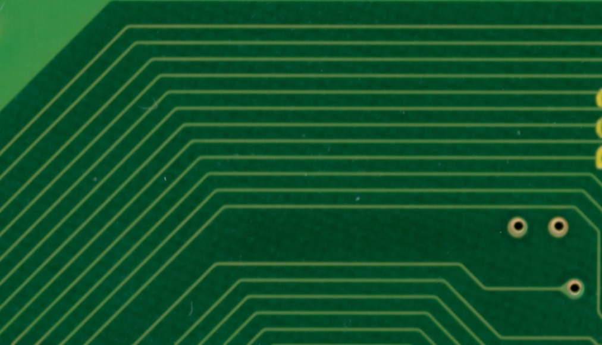

A trace is a thin, conductive path on a PCB that allows electrical signals to travel between different components. It is typically made of copper and acts like a wire, connecting parts like resistors, capacitors, or ICs. Traces are carefully routed to ensure signals travel efficiently with minimal interference.

### What is a Via?

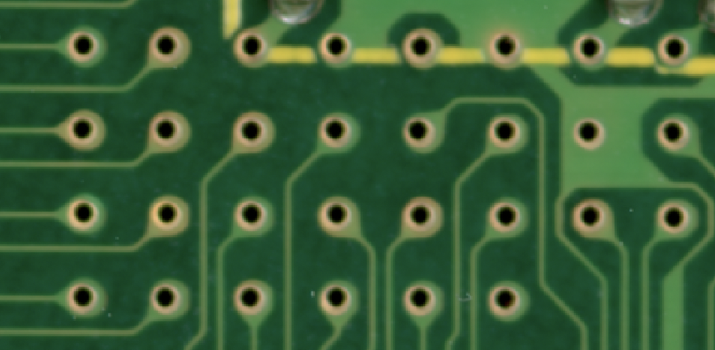

A via is a metal plated hole drilled through the PCB that provides a conductive pathway allowing electrical connections between different layers of a PCB. It acts like a trace that passes through one or more layers, making it possible for signals to travel between components on different levels of the board. For example, in a multi layer PCB, a via connects a trace on the top layer to another trace on the bottom layer, allowing components on different layers to connect.

### What is Silkscreen?

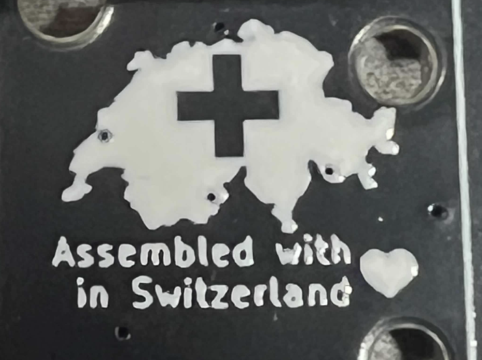

Silkscreen is the layer on a PCB that contains printed ink labels, symbols, and markings to help identify components and other important information. It is usually printed in white (but can be other colors) on the top and/or bottom of the board. Silkscreen markings include part labels like `R` for resistors or `C` for capacitors, polarity indicators, logos, and other helpful guides for assembling or troubleshooting the PCB.

### What is a Capacitor?

Capacitors come in many shapes and sizes. They store electrical charge and release it when needed. Capacitors help smooth out signals and can supply temporary power during brief interruptions. They are referenced by the letter `C` on silkscreen markings.

### What is a Resistor?

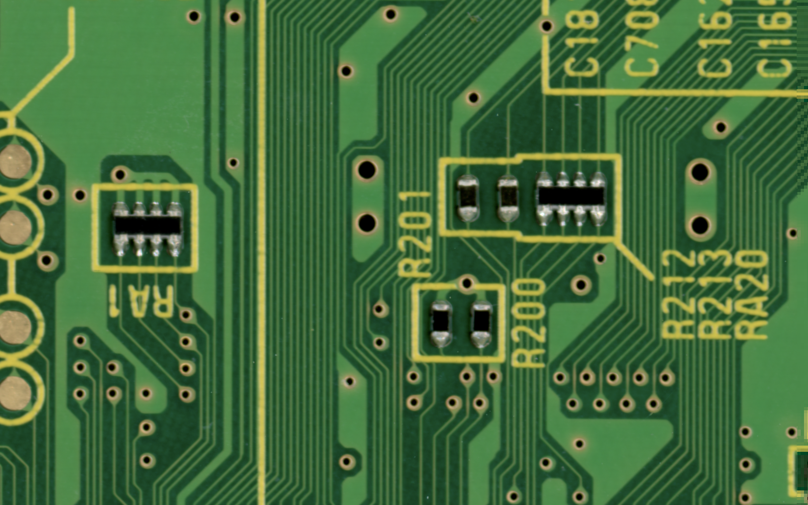

Resistors also come in various packages, and small surface mounted ones often resemble capacitors. They are typically black and labeled `R` on silkscreen markings. Resistors limit (or resist) the flow of electrical current and lower the voltage by converting electrical energy into heat.

### What is a Thermistor?

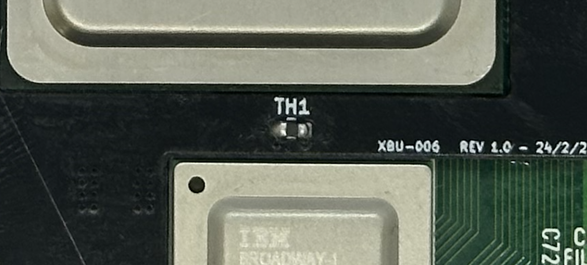

A thermistor is a type of resistor that changes its resistance based on temperature. While all resistors are affected by temperature to some extent, thermistors are specifically designed to be highly temperature-sensitive. Their resistance either increases (**p**ositive **t**emperature **c**oefficient, "**PTC**") or decreases (**n**egative **t**emperature **c**oefficient, "**NTC**") as temperature changes. Thermistors are typically black and labeled `TH` on silkscreen markings. They are commonly used in temperature sensors, and in devices like the Wii, it can be used to detect overheating.

### What is an IC?

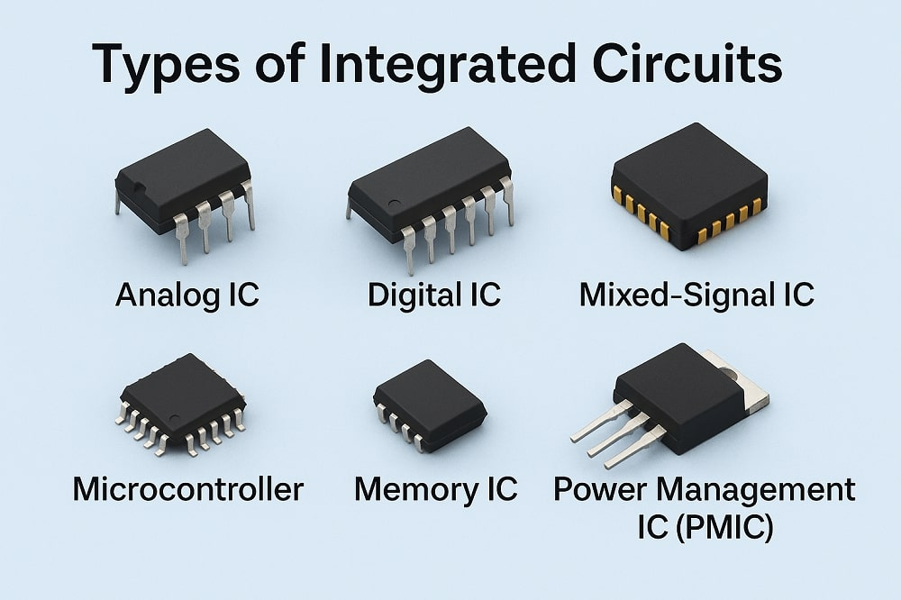

An **IC** (**I**ntegrated **C**ircuit) is a small package that contains an entire electronic circuit. It combines multiple components into a compact form, allowing for more complex functionalities in a small space.

### What is I2C?

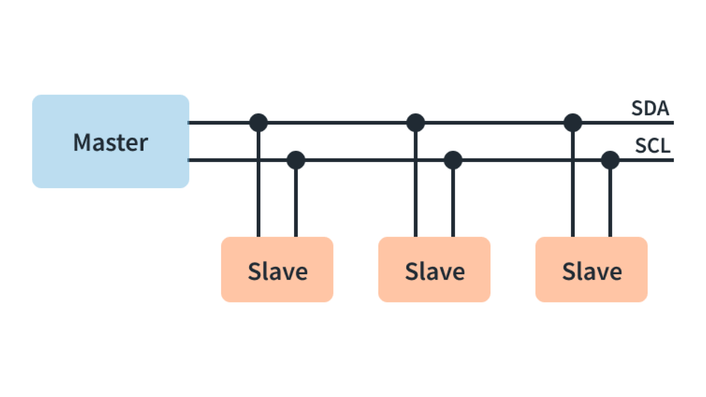

I2C (**I**nter-**I**ntegrated **C**ircuit) is a communication protocol that allows multiple devices to communicate with each other using only two wires \- one for data and one for a clock signal. In the Xii-Boy Ultra, the protocol is used for communication between the Wii, Video Driver, Audio Amplifier, and Power Management System. Each device on the I2C bus has a unique address, and the master device (Wii) initiates communication, sending data or commands to the appropriate device. The traditional naming of I2C lines is `SDA` (Data) and `SCL` (Clock). However, some community companies refer to these same I2C lines as `SDW` (Data) and `SCW` (Clock).