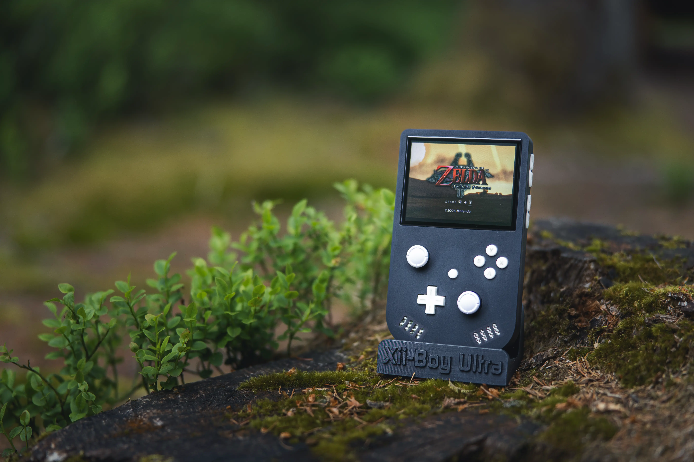

# Introduction

The **Xii-Boy Ultra** is an [open-source project](https://github.com/Xenii1642/Xii-Boy-Ultra) made to convert a Nintendo Wii into a feature-packed handheld game console. This is done by trimming nonessential components from the Wii’s motherboard and replacing them with compact, custom-made alternatives. [RVLoader](https://github.com/Aurelio92/RVLoader), a Homebrew game loader built for portables, allows for even more customization and flexibility than the stock operating system. The standout features of the Xii-Boy Ultra are that it’s **wire-free**, **feature-packed**, **elegant**, and **well-supported by the community**.

This guide is made to help modders assemble their own with step-by-step instructions. **Prior soldering and repair experience is not required, but it is highly recommended.** The **Xii-Boy Ultra** is an excellent candidate for a first portable to build as long as modders take their time and follow all directions. It is highly reccomended to read over the guide and be familliar with the process **before** purchasing parts or tools. Due to the open source nature of this project, there are two ways to get parts for the build.

<!-- TODO: Reword Above. Make it more professional -->

## Method 1: Purchase a Kit from the Xii-Shop.

This is a kit with nearly all the parts required for this project. On top of supporting the creators, it skips the hassle of dealing with multiple suppliers for the PCBs, case, and components. Everything will be delivered in one neat package, and all **Xii-Boy Ultra** carrier PCBs will arrive assembled (excluding modules from 4 Layer Technologies). This is often the simplest option, and it will reduce total shipping costs, tarrifs and customs, and avoid buying in bulk (e.g. PCBs must be bought at a minimum quantity of 5 from most suppliers). Kits are available for purchase [here](LINK HERE).  

:::warning Warning: Batteries Not Included
There are a few parts that need purchased separately. The most notable are:

- **4-layer Wii Motherboard**
- **Wii Wi-Fi and Bluetooth Modules**
- **Castellated Modules - [RVL-PMS2](https://4layertech.com/collections/modular-line/products/rvl-pms-2), [RVL-DD](https://4layertech.com/products/rvl-dd), [RVL-AMP](https://4layertech.com/products/rvl-amp?variant=43191030153451), [PMS-PD 3](https://4layertech.com/products/pms-pd-3), and [GC+2.0](https://4layertech.com/products/gc-2)**
- **[Two 3.7V 18650 Li-Ion Batteries](https://liionwholesale.com/products/vapcell-n40-18650-10a-flat-top-4000mah-battery-genuine?srsltid=AfmBOor21e7UFz9PdcsTg40_RzTT6Ku3JZvD6_bks11D7F_pFHPyyYmp&variant=40592451371077)**
- **[A MicroSD Card (512GB Reccommended)](https://a.co/d/eyZ4Zkw)**

For more information, view the kit details [here](LINK HERE)
:::

## Method 2: Source Parts from Multiple Suppliers of Choice.

In this method, carrier PCBs will be created by a PCB fabrication house such as **PCBWay** or **JLCPCB**. Small components will be purchased from an electronic parts distributor like **Digikey** or **Mouser**. The 3D printed shells will be printed through a service like **PCBWay** or **JLC3DP** or at a local makerspace. 

In-depth instructions to sourcing may be available on the **Xii-Boy Ultra Guide** in the future. For the time being though, please refer to the [Github Repository](https://github.com/Xenii1642/Xii-Boy-Ultra) for general information and ask in the [Discord Server](https://discord.gg/dgDmBvEUQG) for specific questions.