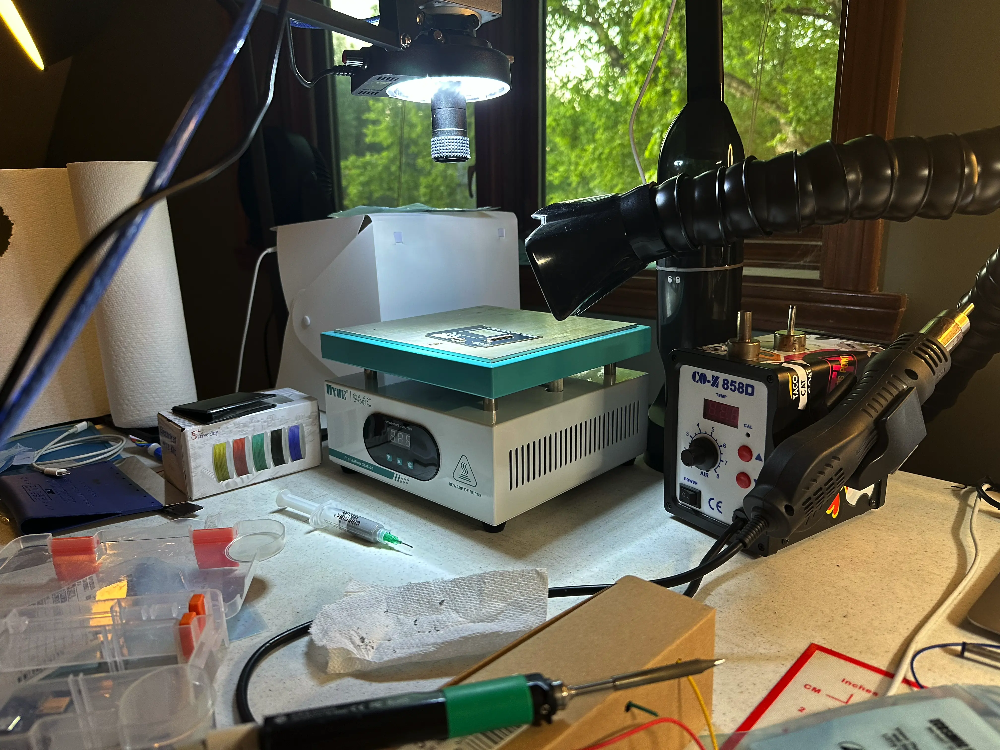

# Materials and Tools

To make the **Xii-Boy Ultra** build as simple as possible, we’ve organized the required materials and tools into an easily accessible list. **Amazon** links are provided whenever possible, but note that cheaper prices may be available at other retailers such as **AliExpress**.

## Soldering Tools

- **Soldering Iron:** [Pinecil V2](https://a.co/d/gzenrbS)  
- **Soldering Iron (Alternative):** [Queco T12 956 soldering station](https://a.co/d/5TNCGkn)  
- **Solder:** [Kester 44 63/37 0.020"](https://a.co/d/5RiIwC2)
- **Solder (Lead-Free Alternative):** [Kester 275 K100LD 0.020"](https://a.co/d/dZMrosN) 
- **Flux:** [Stirri V2-TF](https://a.co/d/fC5cPg5)  
- **Flux (Alternative):** [Chip Quik SMD491](https://a.co/d/aVsHH8v)  
- **Solder Braid:** [CHEMTRONICS 80-3-5 BRAID](https://a.co/d/e1kGg4Q)  
- **Microscope:** [Amscope 7x-45x](https://www.ebay.com/itm/140938262240)  
- **Magnifying Lamp (Microscope Alternative):** [2.25x Light Magnifier](https://a.co/d/9xPGy3s)  
- **Hot Air Gun (Optional):** [858D Hot Air Station](https://a.co/d/hCR4eZt)  
:::details Why is it Optional?
A **Hot Air Gun** or **Hot Air Rework Station** is useful for heating large components or many components at once. However, it often takes longer than a Soldering Iron to transfer heat, and it risks melting or blowing parts around. On the Wii motherboard, a Hot Air Gun is the most practical way to remove the `1.8V LDO`. Removal is also possible with a **Dremel** and **Soldering Iron** if done carefully.
:::

## Hand Tools

- **Dremel:** [Dremel Tool](https://a.co/d/eT733dP)  
- **EZ Lock Diamond Cutting Wheels:** [Diamond Cutting Wheels](https://www.homedepot.com/p/Dremel-EZ-Lock-Rotary-Tool-Mandrel-with-EZ-Lock-1-1-2-in-Rotary-Tool-Diamond-Tile-Cutting-Wheel-for-Tile-and-Ceramic-Materials-EZ402-EZ545/313823691)  
:::details Will Other Types of Wheels Work?
**No!** The default wheels are not sharp enough and will struggle to cut through the Wii motherboard. This makes it more likely to **skip** and unintentionally cut components **or yourself**. Wheels with teeth (like on a table saw) are more rare on rotary tools or Dremels, but they are **extremely dangerous** and should be **avoided at all costs** as well. Use a diamond wheel for this project, preferably EZ Lock.
:::
- **Pliers (Needle Nose and Diagonal Cutting):** [Pliers Set](https://a.co/d/cr09Rg4)  
- **Fine-Tipped Tweezers:** [Tweezers](https://a.co/d/5OKSr2a)  
- **Screwdriver Set:** [Screwdriver Set](https://a.co/d/jk59Y1K)  
:::details Tri-Point (Y0) Screwdriver Length
Ensure the Tri-Point (Y0) screwdriver has a long shaft to reach recessed screws in the Wii. The linked set has one with the correct sizing.
:::

## Safety Gear

- **Painting Respirator and Safety Glasses:** [Safety Gear](https://a.co/d/cBycqXN)  
- **Fume Extractor:** [VEVOR 100W - Recommended](https://a.co/d/aJNU2gH)  
- **Fume Extractor (Alternative):** [ZIOPETRU Tabletop - Budget](https://a.co/d/7LO8QsM)  

## Electronics and Accessories

- **Multimeter:** [Multimeter](https://a.co/d/7Qe2EVw)  
- **24 AWG Wire Set:** [Wire Set](https://a.co/d/bMAj78b)  
- **MicroSD to USB Adapter:** [MicroSD Adapter](https://a.co/d/g2JveM3)  
- **Clear Tape:** [Scotch Magic Tape](https://a.co/d/2b0gQCw)
- **91% Isopropyl Alcohol:** [91% IPA](https://a.co/d/0dYH3O8)
- **Cotton Swabs / Q-Tips:** [Cotton Swabs](https://a.co/d/7KwuABb)

## Other / Sourcing

- **4-Layer Wii (eBay Link):** [For Parts or Repair Wii](https://www.ebay.com/sch/i.html?_nkw=Nintendo+Wii+Broken+Disc+Drive&_sacat=0&_from=R40&_sop=10&rt=nc&LH_BIN=1)  
:::details What to Search For
Broken Wiis can often be found in the **$20-$25** range after shipping. When portabilizing, the disc drive is scrapped, so search for **4-layer Wiis** with non-functional drives. Use the **[Wii Revision Checker](https://wii-revision.netlify.app/)** and refer to [Wii Preparation](/wii-preparation#wii-preparation) to confirm the Wii is 4-layers before purchasing.
:::
