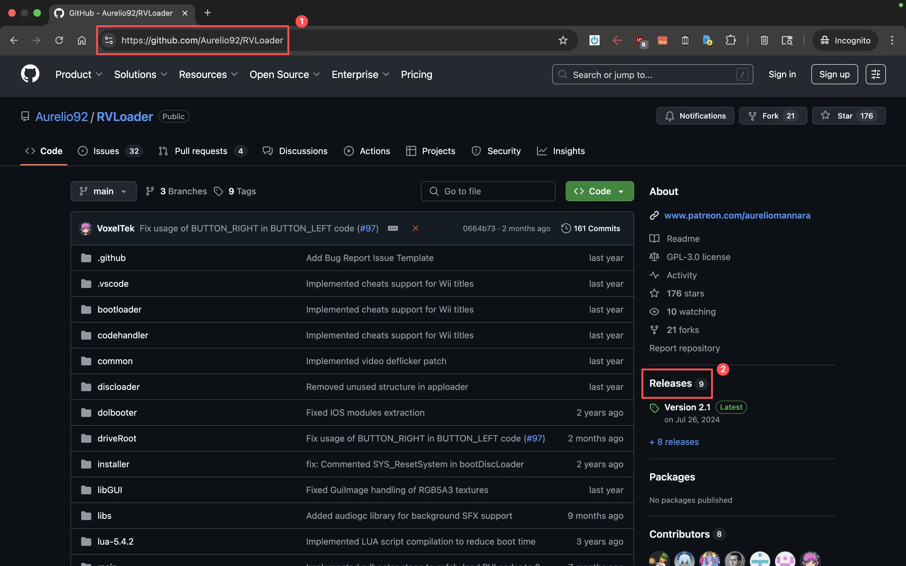
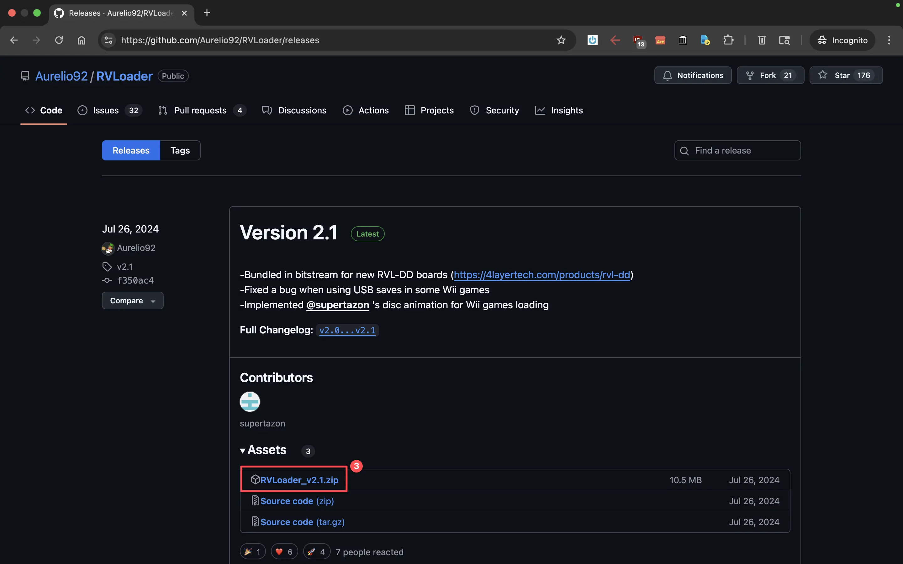
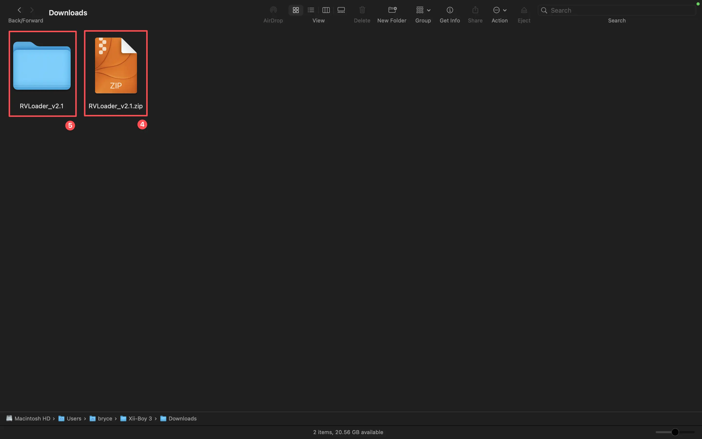
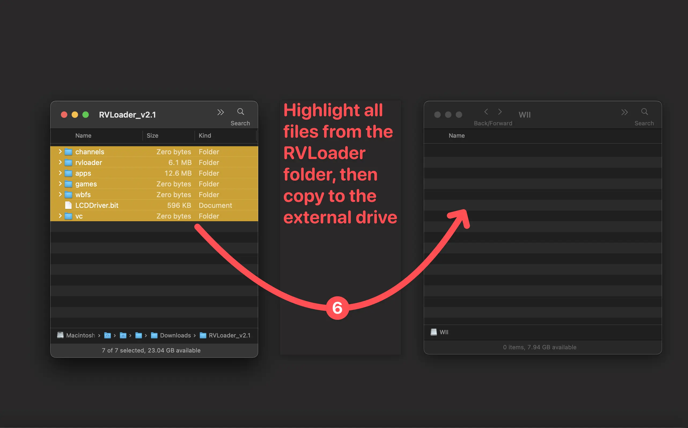
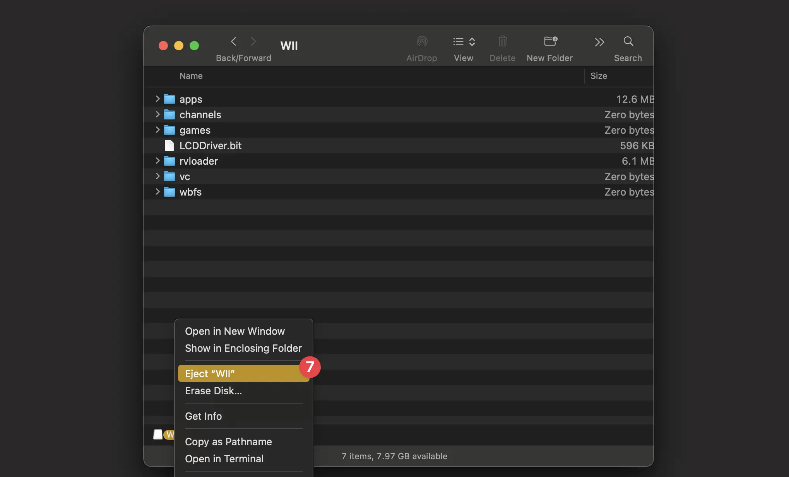

# Wii Preparation

## Identify the Wii’s Revision

There are several revisions of the Nintendo Wii motherboard, but for this guide, only one difference really matters: the type of processor the board uses. To build a portable Wii that runs cool and uses less power, a motherboard with the **Hollywood-1 SoC** (**S**ystem **o**n **C**hip) is required. These are often called **“4-layer Wiis”** because the **Hollywood-1** is always paired with a **4-layer PCB** as opposed to the older revision’s **6-layer PCB**.

**The following motherboard revisions will always be 4-layer:**

* `RVL-CPU-40`
* `RVL-CPU-50`
* `RVL-CPU-60`
* `RVK-CPU-01`
* `RVK-CPU-02`

### How to Find a 4-Layer Wii
* **Colored Wiis (Black, Blue, or Red):** Always 4-layer with Hollywood-1 or newer.
* **White Wiis:** Could be 4-layer or 6-layer, depending on when they were made.

<!-- TODO: Add something about identifying the revisions by looking at the board -->

To confirm the revision without opening the Wii, go to the **[Wii Revision Checker](https://wii-revision.netlify.app/)** and enter the Wii’s serial number.

:::warning Wii Mini Compatibility
The [Wii Mini](https://nintendo.fandom.com/wiki/Wii_Mini) (`RVO-CPU-01` and `RVO-CPU-10`) has a different board layout, and is not supported by the **Xii-Boy Ultra**. 
:::

:::details Want to Learn More About Wii Revisions?
To learn more about all the different Wii board versions, check out the [Wiki page by Rare Gaming Dump](https://wiki.raregamingdump.ca/index.php/Wii/Board_Revisions).
:::

## Software Preparation

### SoftMod the Wii

Before proceeding, the Wii must be "softmodded" with the **Homebrew Channel**. The definitive guide for this can be found at [Wii Hacks Guide](https://wii.hacks.guide/str2hax). After the **Homebrew Channel** is installed, proceed with the instructions for **Installing RVLoader**.

### Install RVLoader

1.  Navigate to the [RVLoader GitHub page](https://github.com/Aurelio92/RVLoader) on a computer.

2.  Select the `Releases` button on the right side of the screen.

3.  Select the `.zip` file of the latest RVLoader release.

4.  Navigate to the computer’s downloads folder (**Finder** on macOS, **File Explorer** on Windows) and double-click the `.zip` archive to extract it.

5.  A folder will be created with the same name, without the `.zip` extension. Open this folder.

6.  Insert the **MicroSD card** into the computer (use a MicroSD to USB adapter if needed). Drag the **contents** of the `.zip` folder onto the **root directory** of the MicroSD card. 

:::details MicroSD Formatting Notice
The MicroSD card must be formatted as FAT32 in MBR with a 32k cluster size in order to work. Most will come in this format out of the box, however if any issues arise, format it with [GUIFormat](http://ridgecrop.co.uk/index.htm?guiformat.htm) on Windows or `Disk Utility` on macOS.
:::

7.  Eject the drive and remove it. Then insert the MicroSD card into the MicroSD to USB adapter and plug it into one of the Wii’s back USB ports.

8.  Power on the Wii and navigate to the Homebrew Channel. Select `RVLoader` from the list and boot it by selecting `Load`. A screen with the question `RVLoader is not installed. Do you want to run the installer?` will be presented. Press `A` to continue, and set the configuration to `Patch out WiFi: Yes` and `Enable VGA: Yes`. Press `Start/Home` to run the install process.

<ImageCarousel step="wii-preparation/rvloader-install" />

**RVLoader** is now successfully installed, and the Wii is ready to be disassembled and trimmed. Note that the Wii will now autoboot into the RVLoader menu. To return to the Wii menu, use the `C-Stick` and hold toward the Wii icon.

<!-- TODO: Update instructions above on navigating rvloader!! -->

## Dumping Wii & GameCube Games

:::warning Critical Step
Games must be dumped **before** trimming the Wii, as the **Xii-Boy Ultra** does not have a disc drive, and games are loaded from the MicroSD card.
:::

Full guides on dumping games can be found on [Wii Hacks Guide](https://wii.hacks.guide/dump-games.html) and [Dolphin's website](https://dolphin-emu.org/docs/guides/ripping-games/). To access game dumping Homebrew from the RVLoader menu, use the C-Stick to navigate to the Homebrew loader section. Wii games need to be stored as `.wbfs` files, and GameCube games need to be stored as `.iso` files. Exact file placement is addressed in [RVLoader Setup](/rvloader-setup).

## Disassemble the Wii

Follow a standard guide to disassemble the Wii and remove the motherboard. The iFixit guide is highly recommended.

* **iFixit Guide:** [Nintendo Wii Motherboard Replacement](https://www.ifixit.com/Guide/Nintendo+Wii+Motherboard+Replacement/3460?revisionid=HEAD)